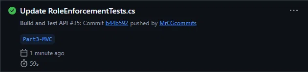

# RaceDay - Event Management System

RaceDay is a full-stack web application designed for the South African road running, walking, and cycling community. It allows Organisers to create and manage events, and Participants to browse, enrol, and track their results.

## 🚀 Technologies Used
* **Backend:** ASP.NET Core Web API (.NET 8), Entity Framework Core, SQL Server
* **Frontend:** ASP.NET Core MVC (.NET 8), Bootstrap 5
* **Storage:** Azure Blob Storage (via Azurite Emulator locally)
* **Testing:** xUnit
* **DevOps:** Docker, GitHub Actions

## 🛠️ Local Setup Instructions

### Prerequisites
* Visual Studio 2022 (.NET 8 SDK)
* SQL Server Express / LocalDB
* Node.js (for Azurite emulator)

### 1. Database Setup
1. Open the solution in Visual Studio.
2. Open the **Package Manager Console** (`View -> Other Windows -> Package Manager Console`).
3. Ensure the Default project is set to `RaceDayAPI`.
4. Run `Update-Database` to create the SQL database.

### 2. Azurite (Azure Storage Emulator) Setup
1. Open a terminal/command prompt.
2. Install Azurite globally: `npm install -g azurite`
3. Start the emulator: `azurite --silent --location c:\azurite`
4. **Leave this terminal open** while running the app.

### 3. Running the Application
1. In Visual Studio, right-click the Solution -> **Configure Startup Projects**.
2. Select **Multiple startup projects**.
3. Set both `RaceDayAPI` and `RaceDayMVC` to **Start**.
4. Press `F5` or click the green Play button.
5. The API will run on `http://localhost:5115` and the MVC app on `http://localhost:5227`.

## 🐳 Docker Setup
To run the MVC application in a Docker container, run the following commands from the root directory of the solution:

```bash
docker build -t raceday-mvc -f RaceDayMVC/Dockerfile .
docker run -d -p 8080:8080 --name raceday-mvc-container raceday-mvc


The app will be accessible at http://localhost:8080.

🎥 Video Presentation
[Add your unlisted YouTube video link here]

## ✅ CI/CD Pipeline

