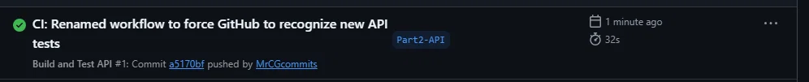

# RaceDay - Event Management System

## Part 1: System Planning and Database
The foundation of the RaceDay system, including the ERD, API Endpoint Plan, and SQL Database Script. (See the `main` branch for Part 1 files).

## Part 2: RESTful API Development

### Setup and Run Instructions
1. Open the solution (`RaceDayAPI.sln`) in Visual Studio 2022.
2. Ensure the `appsettings.json` connection string points to your local SQL Server Express instance.
3. Open the Package Manager Console and run `Update-Database` to create the database.
4. Press `F5` to run the application. Swagger UI will open automatically in your browser.

### API Features
- **Authentication:** Cookie-based session management using BCrypt for password hashing.
- **Role-Based Access Control (RBAC):** Enforced at the API level (Organisers manage events/categories/results; Participants enroll and view their own data).
- **Database:** Entity Framework Core (Code-First approach) connected to SQL Server.
- **Testing:** xUnit and Moq used for unit testing (6/6 tests passing locally and via CI/CD).

### CI/CD Pipeline
The GitHub Actions workflow automatically builds the project and runs all unit tests on every push to the `Part2-API` branch.

## User Roles
The system supports two distinct roles:
- **Organiser:** Can create, edit, and delete events, manage event categories, capture participant results, and view all event enrolments.
- **Participant:** Can create an account, browse events, enter an event by selecting a category, view their own enrolments, and track their personal results.

## Project Links
- **YouTube Video Presentation (Part 2):** [Insert Unlisted YouTube Link Here]
- **Part 1 YouTube Video:** [Insert Part 1 Link Here, if you have it]